# Store POS System

[](https://github.com/Mustafakumru/store-pos-system/actions/workflows/ci.yml)

Perakende mağazalar için uçtan uca kasa (POS) sistemi: **WPF kasa uygulaması**, **ASP.NET Core API** ve
**Angular yönetim/mağaza paneli**. Satış, iade/değişim, hediye kartı, kasa açılış/kapanış, X/Z raporu,
depo → mağaza sevkiyatı, çevrimdışı satış, termal fiş yazıcısı, satış hedefleri ve değiştirilemez işlem kaydı.

> LC Waikiki'de kasiyer olarak çalıştığım dönemde gözlemlediğim mağaza süreçlerinden (iade, değişim, kasa
> teslimi, Z raporu) esinlenerek geliştirdiğim kişisel bir projedir; şirketin resmi yazılımı değildir ve
> şirkete ait kod ya da veri içermez.

| Kasa uygulaması (WPF) | Yönetim paneli (Angular) |
|---|---|
| 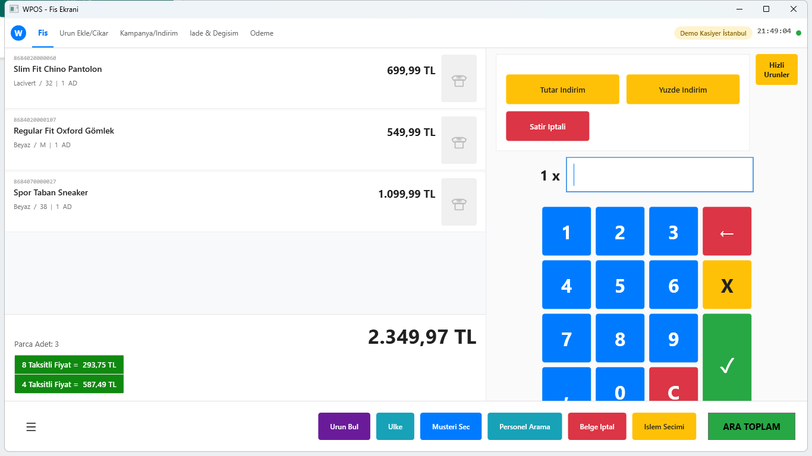 | 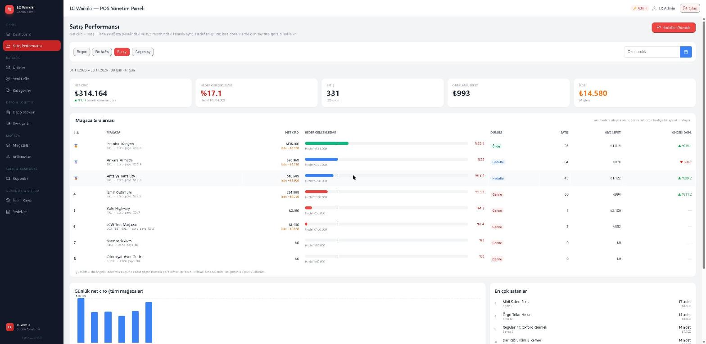 |
| 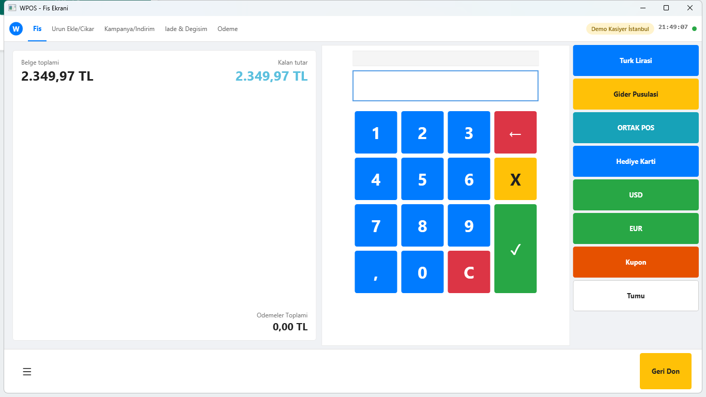 | 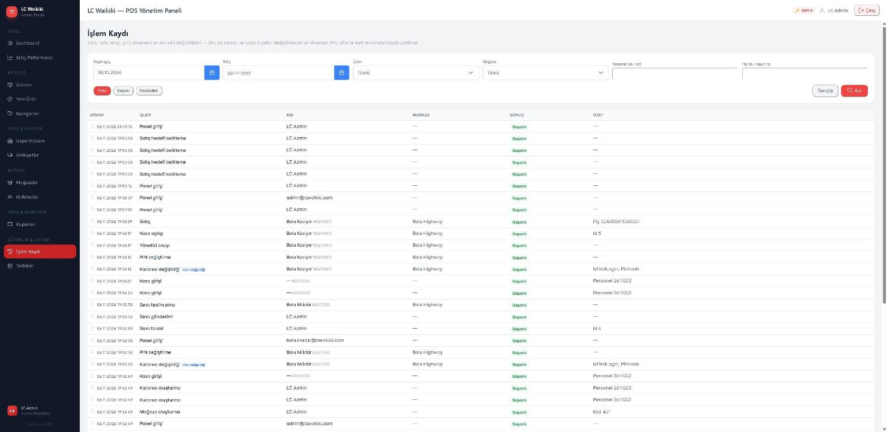 |

<details>
<summary><b>Diğer ekranlar</b> (ürün bulma, kasa açılışı, mağaza paneli, termal fiş…)</summary>

| | |
|---|---|
| 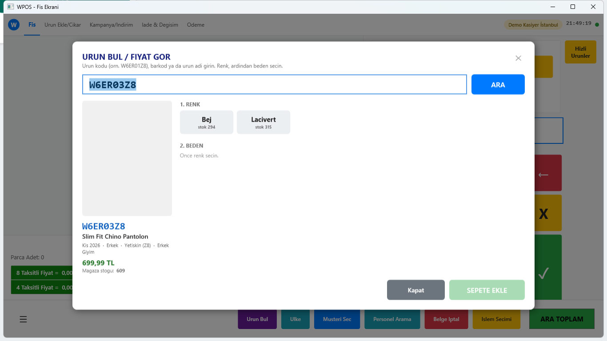 Barkodsuz ürün bulma: ürün kodu → renk → beden | 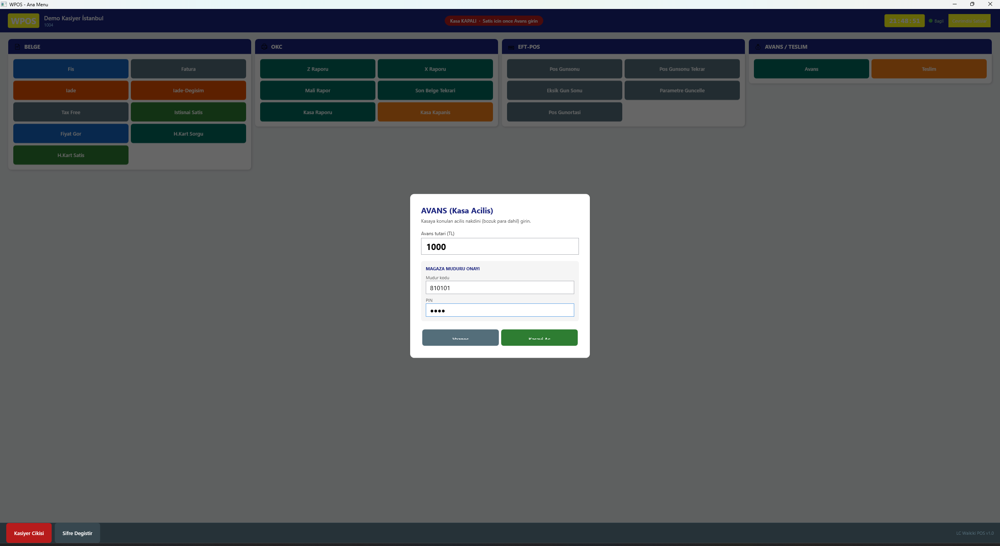 Müdür onaylı kasa açılışı |
| 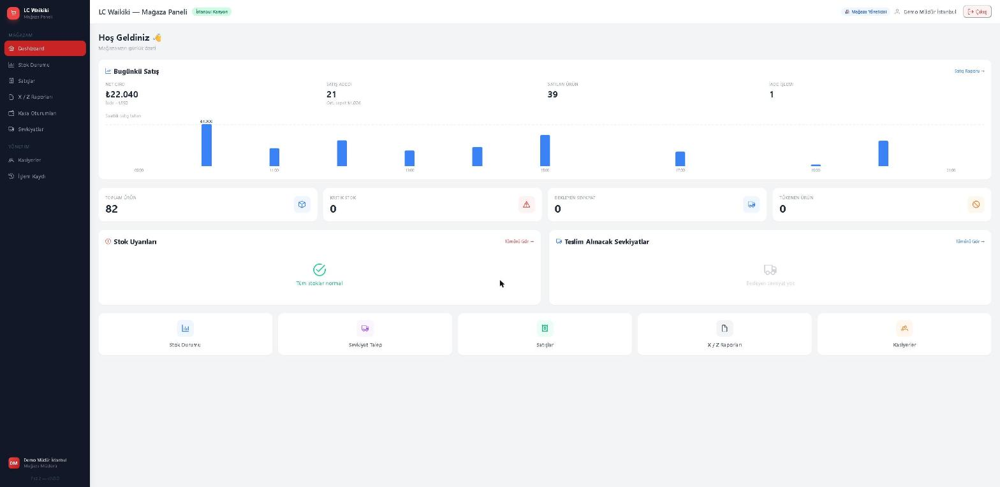 Mağaza müdürü paneli | 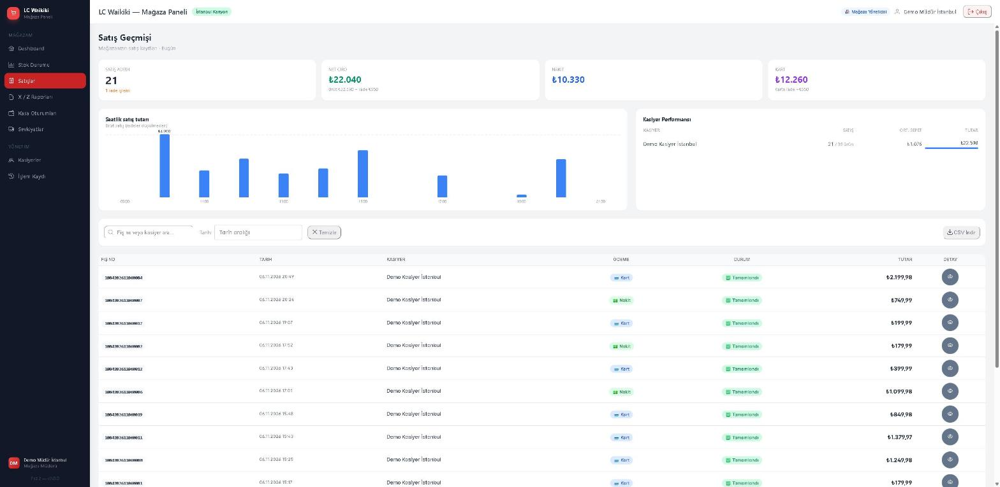 Satış geçmişi ve kasiyer performansı |
| 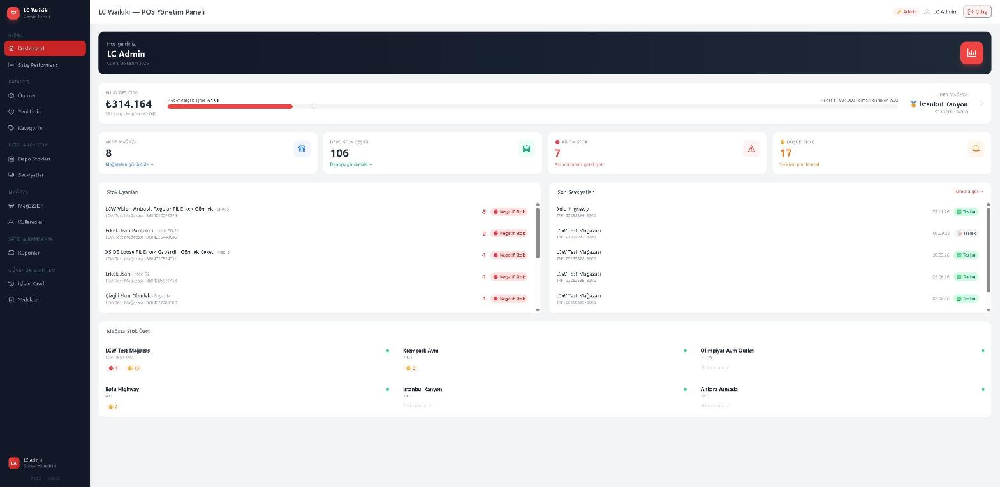 Admin panosu: bu ay ciro / hedef | 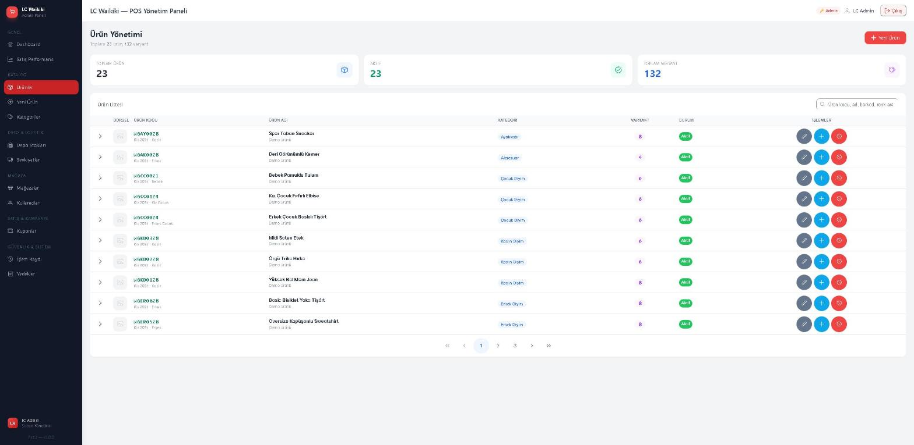 Ürün kodu sistemi (W6ER03Z8) |
| 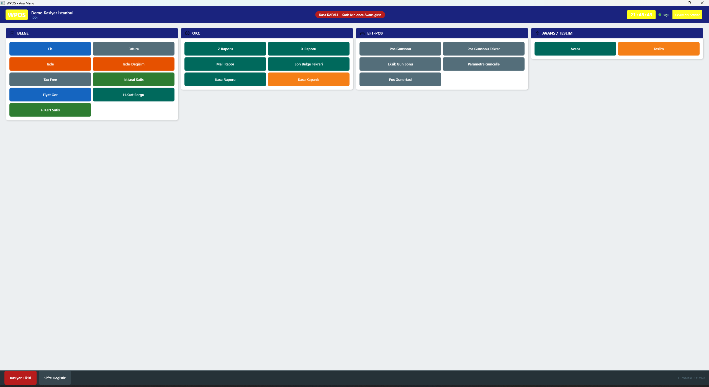 Kasa ana menüsü | 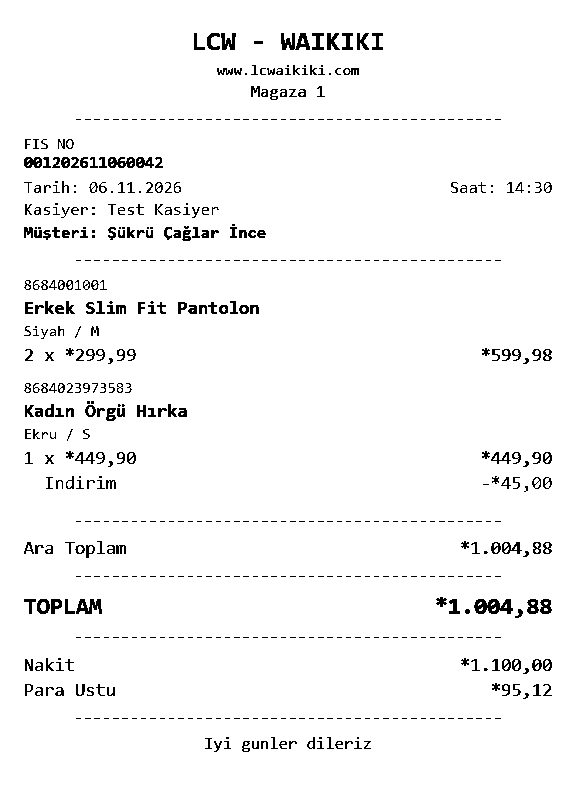 ESC/POS ile basılan 80 mm fiş (yazıcıya giden baytlardan geri çözülmüş) |

</details>

## Öne çıkanlar

- **Para ve stok hareketlerinde eşzamanlılık güvenliği** — aynı fişe aynı anda iki iade, aynı hediye kartıyla iki
  kasada harcama, aynı ürünün 15 kasada aynı anda satışı: rowversion + otomatik yeniden deneme ile hiçbiri
  bakiyeyi/stoğu bozamaz (testlerle kanıtlı).
- **Tekrar gönderim koruması (`Idempotency-Key`)** — ağ koptuğunda tekrar basılan "Ödeme" ikinci fiş kesmez,
  ilk yanıt döner.
- **Çevrimdışı satış** — sunucu yokken kasa yerel katalogla satışa devam eder; bağlantı gelince satışlar aynı
  işlem anahtarıyla gönderilir, satış anındaki fiyat sunucuda doğrulanır.
- **Değiştirilemez işlem kaydı** — kim, hangi mağazada, ne zaman, ne yaptı; PIN/şifre/kart no maskeli;
  veritabanı tetikleyicisi doğrudan SQL ile silmeyi de reddeder.
- **Satış performansı ve hedefler** — mağaza sıralaması, aylık hedef, "olması gereken" ilerlemeye göre
  Önde/Hedefte/Geride.
- **Termal fiş** — fiş 203 dpi raster olarak ESC/POS ile basılır (Türkçe karakter sorunu yok), PDF arşivi.
- **Ürün kodu sistemi** — 8 haneli model kodu (sezon + yıl + kategori + sıra + yaş grubu) ve EAN-13 barkod üretimi.
- **Güvenlik** — PBKDF2 PIN, kilitleme, istek sınırı, tek kullanımlık yönetici onay token'ı, oturum süresi dolunca
  sepet kaybolmadan PIN ile yeniden giriş, canlıda hatalı yapılandırmayla açılmayan API.
- **174 otomatik test** — gerçek SQL Server üzerinde entegrasyon testleri + sunucusuz kasa uygulaması testleri; CI.

Tasarım kararlarının "sorun → çözüm → nasıl test edildi" anlatımı: **[docs/teknik-kararlar.md](docs/teknik-kararlar.md)**

## Mimari

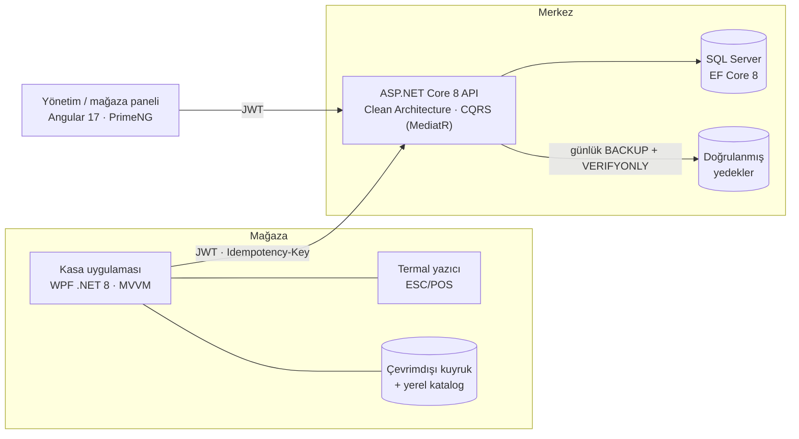

| Bileşen | Teknoloji | Klasör |
|---|---|---|
| API | ASP.NET Core 8, Clean Architecture (Domain / Application / Infrastructure / WebAPI), MediatR, FluentValidation, EF Core 8, SQL Server, JWT | `Domain`, `Application`, `Infrastructure`, `WebAPI` |
| Yönetim / mağaza paneli | Angular 17 (standalone, signals), PrimeNG, Tailwind | `lcw-pos-admin` |
| Kasa uygulaması | WPF (.NET 8), CommunityToolkit.Mvvm, PdfSharp | `LCWaikiki.POS.WpfClient` |
| Testler | xUnit, WebApplicationFactory, gerçek SQL Server | `tests/` |

## Çalıştırma (5 dakika)

Gereksinimler: .NET 8 SDK, Node 20, SQL Server LocalDB (Visual Studio ile gelir) — kasa uygulaması için Windows.

```bash
# 1) API — ilk açılışta veritabanını oluşturur, geliştirme hesaplarını ve DEMO VERİSİNİ üretir
dotnet run --project WebAPI --launch-profile https      # https://localhost:7164/swagger

# 2) Panel
cd lcw-pos-admin && npm install && npx ng serve         # http://localhost:4200

# 3) Kasa uygulaması (Windows)
dotnet run --project LCWaikiki.POS.WpfClient
```

Demo verisi (yalnızca geliştirmede): 4 mağaza, 12 ürün, son 60 günde ~2.800 satış, iadeler, stoklar ve
farklı tempolarda aylık hedefler — raporlar ilk açılışta dolu görünür.

### Demo hesapları (yalnızca geliştirme ortamı)

| Rol | Nerede | Giriş |
|---|---|---|
| Admin | Panel | `admin@lcwaikiki.com` / `Admin123!` |
| Mağaza müdürü (İstanbul Kanyon) | Panel | `demo.101@lcwaikiki.com` / `Demo123!` |
| Kasiyer (İstanbul Kanyon) | Kasa | personel no `810102`, PIN `1357` |
| Mağaza müdürü — kasa açılışı / onaylar | Kasa | personel no `810101`, PIN `4826` |
| Diğer demo mağazalar | | `201` Ankara, `301` İzmir, `501` Antalya: aynı kalıp (`demo.201@…`, `820102` …) |

Demo barkodları için panelde **Ürünler**'e bakın ya da kasada **Ürün Bul** ile ürün kodunu (örn. `W6ER03Z8`) yazın.

## Testler

```bash
dotnet test        # 132 API (gerçek SQL Server / LocalDB) + 42 kasa uygulaması testi
```

Eşzamanlılık, tekrar gönderim, çevrimdışı satış, yedekten geri dönüş, işlem kaydının değiştirilemezliği,
yetki sınırları ve ESC/POS çıktısı test edilir. Ayrıntı: [docs/testler.md](docs/testler.md) · CI:
[docs/yapilandirma.md](docs/yapilandirma.md#ci-github-actions)

## Belgeler

- [Teknik kararlar](docs/teknik-kararlar.md) — sorun → çözüm → test
- [Özellikler (ayrıntılı)](docs/ozellikler.md) — çevrimdışı satış, satış performansı, termal yazıcı, kategoriler, işlem kaydı, yedekleme
- [Yapılandırma, canlıya alma ve CI](docs/yapilandirma.md)
- [Testler](docs/testler.md)
